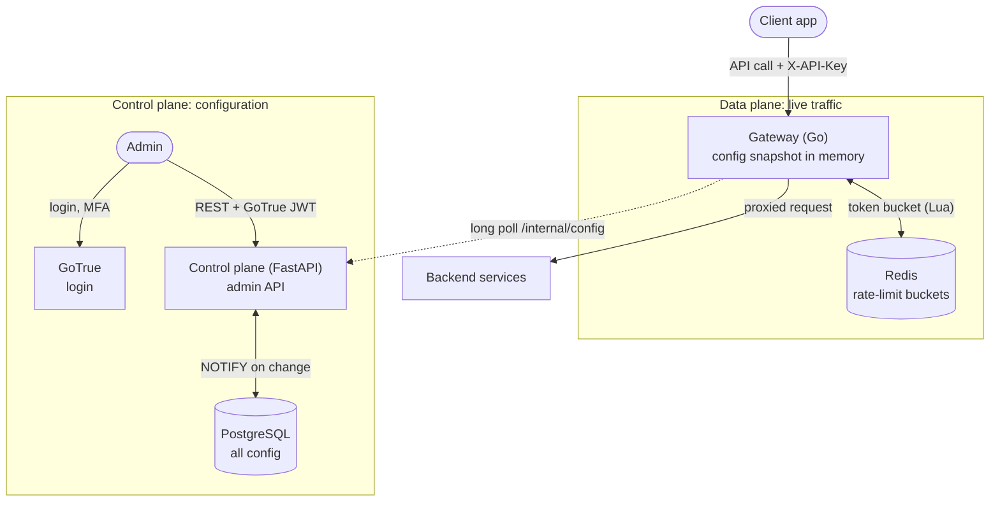
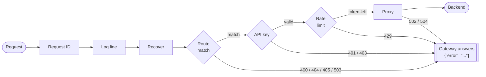

# API Management Platform

[](https://github.com/Ali-Odeh/API-Management-Platform/actions/workflows/ci.yml)

A self-hosted API gateway and its management API, modeled on Kong, Tyk and Apigee. A **Go gateway** sits in front of your backend services: every API call passes through it and is routed, authenticated with an API key, rate-limited per consumer and logged. A **FastAPI control plane** is where admins configure it, and changes reach the gateway in milliseconds. People log in with **GoTrue** (Supabase Auth, self-hosted), with MFA for the Platform Admin.

It is a learning project, built step by step with production habits: tests at every layer, fuzzing, an end-to-end suite, a load test and CI on every push.

## What it does

- **Routing:** `/v1/orders/...` goes to the orders service, by longest path prefix and HTTP method, on whole path segments.
- **API keys:** consumers (client apps) get keys, shown once and stored hashed. No key or a wrong key is `401`, a blocked consumer is `403`.
- **Rate limiting:** a token bucket per consumer and one per workspace in Redis, checked together in one atomic Lua script shared by every gateway instance. Over either limit is `429` with `Retry-After`. If Redis is down, traffic still flows (fail open).
- **Load balancing and health checks:** a service runs on several backend instances (targets) with weights; the gateway spreads requests by smooth weighted round robin and avoids a broken instance, found by periodic health checks and by failures in real traffic (`503 no_healthy_upstream` when none is left).
- **CORS and body limits:** browser apps can call a route from the origins it allows (the gateway answers preflights itself); request bodies over a route's limit get `413` before they reach a backend.
- **SSRF protection:** a tenant's service can't point the gateway at the platform's insides (private, loopback, link-local and cloud-metadata addresses). The gateway checks the address it really connects to, after DNS, so DNS rebinding doesn't help; the control plane refuses plainly internal URLs on save. The Platform Admin can allow exceptions (`UPSTREAM_ALLOW`).
- **Noisy-neighbor protection:** each workspace may have only so many requests in flight per gateway instance (`503 workspace_overloaded` beyond that), so a slow backend in one workspace can't tie up the gateway for the others.
- **Reverse proxy:** per-route timeouts (`504`), dead backends (`502`), optional prefix stripping, trusted `X-Forwarded-*` headers. The backend never sees the API key; it gets `X-Consumer-ID`.
- **Observability:** a request ID on every call, and one JSON log line per request with the route, the consumer, the status and how long the backend and the gateway each took.
- **Login:** GoTrue handles passwords, TOTP MFA, rotating refresh tokens and emails; the control plane verifies its tokens and decides what each person may do from its own tables. A disabled person is refused on their very next request.
- **Developer portal:** developers sign up on their own GoTrue (open sign-up, confirmed by email; never mixed with workspace members) and browse each workspace's catalog: the APIs it has published, with their OpenAPI documents. Drafts stay hidden, deprecated APIs are marked. Then they serve themselves: an app on a plan the workspace offers (an API Admin approves it first when the plan says so), keys, calls through the gateway, their own usage and remaining monthly quota. Every app is a consumer underneath, so the gateway needed no change.
- **Backup and restore:** a script dumps the platform's and both GoTrues' databases; another restores them into a fresh stack only and rotates the config generation. Tried for real: a key made before the backup works at the restored gateway.
- **Live configuration:** admins change services, routes, consumers and keys through a REST API (GoTrue JWT). The gateway long-polls the control plane and swaps in the new config without locks: a revoked key stops working in about 70 ms.

## Architecture



The **data plane** (the gateway) handles live traffic and never touches the database: it keeps routes and key hashes in memory and only calls Redis for rate limits. The **control plane** owns the configuration. When an admin changes anything, a Postgres trigger bumps a version and sends `NOTIFY`, the waiting long-poll request returns the new snapshot, and the gateway swaps it in atomically. If the control plane is down, the gateway keeps serving with its last config.

### One request through the gateway



## Numbers

| | |
| --- | --- |
| **Time the gateway adds** | **0.9 ms median, 1.1 ms p95** with all of v2 on (MT.12: 0.8 ms median, 1.1–1.2 ms p95) (k6, 300 requests/s, 0 errors, a tenant's subdomain, two backend targets). Its own work, the Redis rate-limit call included (workspace and consumer buckets in one round trip), about 0.37 ms; the rest is the extra network hop. [Details](loadtest/README.md) |
| **Config propagation** | An admin change reaches the gateway in about **4 ms** (only the changed workspace is sent) |
| **Route matching** | 0.4 µs for 100 routes, no memory allocations (Go benchmark) |
| **Gateway tests** | 575 tests and table cases, **98% coverage**, the race detector, 9 fuzz tests |
| **Control plane tests** | 2,187 tests, **99% coverage**, mypy strict; permission, isolation and audit guards over every endpoint, the portal's too |
| **End to end** | 66 stories on the real stack (the developer portal from sign-up to a revoked key, GoTrue login with MFA, two tenants on their own subdomains, roles, audit log, invitations, lifecycle, limits, SSRF, load balancing, CORS, the request log and analytics), in CI on every push |

The load test ran on one laptop with Docker Desktop; the differences between runs (with and without the gateway) are the meaningful part.

## Quick start

Requirements: [Docker](https://www.docker.com/) with Docker Compose.

Windows (PowerShell):

```powershell
git clone https://github.com/Ali-Odeh/API-Management-Platform.git
cd API-Management-Platform
.\scripts\init-env.ps1
docker compose up -d --build --wait
```

macOS / Linux:

```sh
git clone https://github.com/Ali-Odeh/API-Management-Platform.git
cd API-Management-Platform
./scripts/init-env.sh
docker compose up -d --build --wait
```

`init-env` creates `.env` with random secrets and prints the Platform Admin's password. When `up` returns, everything is running:

| | Address |
| --- | --- |
| The app: dashboard and Platform pages (sign in as the Platform Admin) | `http://localhost:5173` |
| The developer portal (sign up as a developer) | `http://localhost:5173/portal` |

How to use the app, role by role: the [user guide](docs/USER_GUIDE.md).
| Gateway (send API calls here) | `http://localhost:8081` |
| Admin API and Swagger UI | `http://localhost:8000/docs` |
| Login (GoTrue) | `http://localhost:9999` |
| Developer sign-up and login (the portal's own GoTrue) | `http://localhost:9998` |
| Emails both GoTrues send (Mailpit) | `http://localhost:8025` |
| Mock backend (an echo service) | `http://localhost:9000` |

## Try it (2 minutes, PowerShell)

Log in with GoTrue as the Platform Admin and register a backend, a route, an app with a limit of 3 requests per minute, and a key for it:

```powershell
$cp  = "http://localhost:8000/api/v1/workspaces/default"   # the `default` workspace
$pw  = (Select-String -Path .env -Pattern '^PLATFORM_ADMIN_PASSWORD=(.*)').Matches.Groups[1].Value
$tok = (Invoke-RestMethod -Method Post "http://localhost:9999/token?grant_type=password" -ContentType application/json `
          -Body (@{ email = "admin@example.com"; password = $pw } | ConvertTo-Json)).access_token
function Add($path, $body) {
    Invoke-RestMethod -Method Post "$cp$path" -Headers @{ Authorization = "Bearer $tok" } `
        -ContentType application/json -Body ($body | ConvertTo-Json)
}

$svc = Add /services  @{ name = "orders"; targets = @(@{ url = "http://mock-backend:9000" }) }
$rt  = Add /routes    @{ service_id = $svc.id; path_prefix = "/v1/orders"; methods = @("GET", "POST") }
$app = Add /consumers @{ name = "mobile-app"; email = "dev@example.com"; rate_limit_per_min = 3 }
$key = (Add "/consumers/$($app.id)/keys" @{ name = "demo" }).key   # shown only this once
```

Now be the app and call the API through the gateway:

```powershell
curl.exe -s http://localhost:8081/v1/orders/7 -H "X-API-Key: $key"
# 200: the mock backend's echo. Note "x-consumer-id" and "x-request-id" in its headers, and no API key.

curl.exe -s http://localhost:8081/v1/orders/7
# 401 {"error":"missing_api_key"}

1..4 | ForEach-Object { curl.exe -s -o NUL -w "%{http_code} " http://localhost:8081/v1/orders/7 -H "X-API-Key: $key" }
# 200 200 429 429: the limit is 3 per minute, and one was used above

docker compose logs gateway --no-log-prefix --tail 3
# one JSON line per request: route, consumer, status, ratelimit, latency_ms, upstream_ms, gateway_ms
```

Or do the same by clicking in Swagger at `http://localhost:8000/docs` (**Authorize** with the `$tok` access token; it lasts 10 minutes). Block the consumer there (`PATCH /api/v1/workspaces/default/consumers/{id}` with `{"status": "blocked"}`) and the next call gets `403` at once.

## How it is built

| Part | Stack |
| --- | --- |
| Gateway (data plane) | Go 1.27, standard library only (`net/http`, `httputil.ReverseProxy`, `log/slog`), plus `go-redis` for the rate limiter |
| Control plane | Python 3.12, FastAPI, SQLAlchemy 2 (async), Alembic, Pydantic v2 |
| Login | GoTrue (Supabase Auth) v2.197, Mailpit for its emails |
| Storage | PostgreSQL 16 (config, and GoTrue's own database), Redis 7 (rate limits) |
| Tests | Go `testing` (table tests, fuzzing, benchmarks, `-race`), pytest + httpx, k6 |
| Runtime and CI | Docker Compose, GitHub Actions |

Some decisions worth a look (all of them, with reasons, are in the [decisions log](docs/ROADMAP.md#decisions-log)):

- **Long polling woken by Postgres `NOTIFY`** instead of polling every few seconds: changes arrive in milliseconds, idle traffic is one request per 30 s, and it's still plain HTTP.
- **An immutable snapshot behind `atomic.Pointer`:** thousands of requests read the config with no locks while it is replaced.
- **One Lua script, using Redis's own clock,** for the token bucket: two gateways can never both take the last token, and clock differences between them don't matter.
- **The rate limit is per consumer, not per key,** so creating more keys doesn't raise the limit.
- **Tenant-ready from day one:** every record belongs to a workspace, so multi-tenancy needs no data migration.

## Project layout

| Folder | What |
| --- | --- |
| [`backend/gateway/`](backend/gateway) | The Go gateway: `cmd/gateway` (main) and `internal/` (config, proxy, middleware, ratelimit, ...) |
| [`backend/control-plane/`](backend/control-plane) | The FastAPI admin API and the developer portal API, organized by feature (users, services, routes, consumers, keys, plans, usage, apis, developers, portal, gateway_config) |
| [`backend/auth/`](backend/auth) | Prepares both GoTrue databases (members' and developers') on the shared Postgres |
| [`backend/mock-backend/`](backend/mock-backend) | A small echo service to proxy to (two copies in Compose, for load balancing) |
| [`e2e/`](e2e) | End-to-end tests against the whole stack |
| [`loadtest/`](loadtest) | The k6 load test and its results |
| [`docs/`](docs) | [Plan](docs/PLAN.md), [roadmap and decisions](docs/ROADMAP.md), [MT design decisions](docs/MT_ROLES_DECISIONS.md), [developer guide](docs/DEVELOPMENT.md), [user guide](docs/USER_GUIDE.md) |
| `frontend/` | The React app (built last, after the backend milestones) |

## Development

Tests, quality checks, migrations, the race detector, fuzzing and the load test are in the [developer guide](docs/DEVELOPMENT.md). The short version:

```powershell
.\backend\control-plane\scripts\check.ps1   # ruff, mypy strict, pytest
.\backend\gateway\scripts\check.ps1         # gofmt, go vet, go test
docker compose run --rm e2e                 # end-to-end tests
docker compose run --rm e2e-browser         # the React app in Chromium
.\frontend\scripts\check.ps1                # frontend checks (local Node 22)
docker compose run --rm loadtest            # k6 load test
```

## Status and what's next

The **MVP is done**: routing, API keys, rate limiting, logging, live configuration, with tests at every level. **Multi-tenancy and login (MT) is done** too: GoTrue login with MFA (MT.1), workspaces with roles and permission checks (MT.2), an append-only audit log (MT.3) and members with email invitations and owner rules (MT.4), the workspace lifecycle (suspend, delete with a 30-day restore, purge) with quotas (MT.5), an incremental config protocol, where the gateway receives only the workspaces that changed (MT.6), gateway tenancy, each workspace on its own subdomain (`acme.<gateway>`) and never mixed with another (MT.7), workspace limits in the gateway, a rate limit and an in-flight limit per workspace (MT.8), SSRF protection (MT.9), load balancing over several targets with active and passive health checks (MT.10), CORS per route with request body limits (MT.11), and the MT definition of done proven end to end on every push, with the load test measured again on a tenant's subdomain and two targets (MT.12). Next on the [roadmap](docs/ROADMAP.md):

- **v2 is complete:** every request is in its workspace's request log, with analytics on top (V2.1: the gateway writes usage events to a Redis Stream, a worker stores them in Postgres by month), plans with monthly quotas and per-IP protection (V2.2), and Prometheus metrics (V2.3).
- **The developer portal is complete:** developers sign up on their own GoTrue (open sign-up, email confirmation) and browse each workspace's published APIs with their OpenAPI documents (P.1); they make apps on offered plans (with approval when a plan needs it), get keys, call through the gateway and see their own usage and quota, with a tested backup and restore (P.2). **The backend is complete.**
- **The React app is complete** (FE.1–FE.4), at http://localhost:5173: login with MFA and the account page; the workspace dashboard (overview with traffic, services and targets, routes with CORS, consumers and keys, plans, APIs and the apps queue, members, activity, logs, settings), by role; the Platform Admin's pages (workspaces' lifecycle and limits, users, developers, the platform's audit log); and the developer portal (sign-up, catalog, OpenAPI docs with a try-it console, apps, keys, usage). Unit tests and browser stories run on every push. **The plan is complete.**
