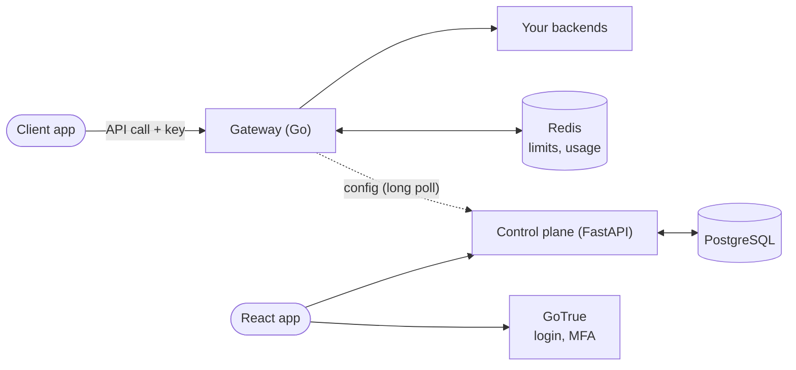

# API Management Platform

[](https://github.com/Ali-Odeh/API-Management-Platform/actions/workflows/ci.yml)

## Overview

Companies that offer APIs need one front door for them: something that checks who is calling, limits how much each caller uses, sends each call to the right server, and shows what happened. This project is that front door, plus the app to run it. It is self-hosted and modeled on Kong, Tyk and Apigee.

**How it works in short:** a company (a **workspace**) adds its backend servers and the paths it wants to expose, then gives each client app a **key** and a **plan** (its limits). Every call goes through the **gateway**, which checks the key and the limits, forwards the call, and logs it. Outside developers can find the APIs on a **portal** and get keys on their own. One **Platform Admin** runs the whole platform.

**Who uses it:**

| Who | Does what |
| --- | --- |
| Platform Admin | Creates workspaces, sets their limits, manages people and developers |
| Workspace team (Owner, API Admin, Viewer) | Builds and runs their APIs, members, keys and plans, and watches the traffic |
| Developers | Find APIs on the portal, read the docs, try them, and get keys |
| Client apps | Call the APIs through the gateway with a key |

**The parts:**

- A **Go gateway** sits in front of your backends. Every API call passes through it to be routed, checked and logged.
- A **FastAPI control plane** stores the configuration. Changes reach the gateway in milliseconds.
- A **React app** has a dashboard for each workspace, pages for the Platform Admin, and a developer portal.
- **GoTrue** (Supabase Auth) handles login, with MFA.

It is a learning project, built with production habits: tests at every layer, an end-to-end suite, a load test and CI on every push.

## Features

- **Gateway:** routing by path and method, API keys, rate limits and monthly quotas, load balancing with health checks, CORS, body limits, SSRF protection.
- **Multi-tenant:** each workspace has its own subdomain, data, limits and members, with Owner, API Admin and Viewer roles.
- **Live config:** a change reaches the gateway in about 4 ms; a revoked key stops working at once.
- **Usage:** every request goes into the workspace's log, with traffic, errors and latency charts, plus Prometheus metrics.
- **Developer portal:** developers sign up, browse the APIs, read the docs, try calls, and get keys for their own apps.
- **Audit log:** who changed what, and when.

## Architecture



The gateway never touches the database. It keeps the config in memory, calls only Redis on a request, and keeps working if the control plane is down.

## Quick start

Requirements: [Docker](https://www.docker.com/) with Docker Compose.

```powershell
git clone https://github.com/Ali-Odeh/API-Management-Platform.git
cd API-Management-Platform
.\scripts\init-env.ps1          # macOS / Linux: ./scripts/init-env.sh
docker compose up -d --build --wait
```

`init-env` creates `.env` with random secrets and prints the Platform Admin's password.

| | Address |
| --- | --- |
| **The app** (sign in as the Platform Admin) | http://localhost:5173 |
| **Developer portal** | http://localhost:5173/portal |
| Gateway (API calls go here) | http://localhost:8081 |
| Admin API docs (Swagger) | http://localhost:8000/docs |
| Emails (Mailpit) | http://localhost:8025 |

## Try it

1. Sign in to the app, open the `default` workspace.
2. Add a **service** (`http://mock-backend:9000`), a **route** (`/v1/orders`), a **consumer**, then **generate a key**.
3. Call the API through the gateway:

```powershell
curl.exe http://localhost:8081/v1/orders/7 -H "X-API-Key: <your key>"
```

You'll see the call on the **Overview** and **Logs** pages a few seconds later. The [user guide](docs/USER_GUIDE.md) explains every role and page.

## Numbers

| | |
| --- | --- |
| Time the gateway adds | **0.9 ms** median at 300 requests/s ([details](loadtest/README.md)) |
| Config change → gateway | about **4 ms** |
| Tests | Go 575 (98% coverage), Python 2,201 (99%), React 153 (97%), 66 API + 8 browser end-to-end stories |

## Built with

Go 1.27 · Python 3.12, FastAPI, SQLAlchemy · React 19, TypeScript, Vite, Tailwind, shadcn/ui · PostgreSQL 16 · Redis 7 · GoTrue · Prometheus · Docker Compose · GitHub Actions

## Project layout

| Folder | What |
| --- | --- |
| [`backend/gateway/`](backend/gateway) | The Go gateway |
| [`backend/control-plane/`](backend/control-plane) | The FastAPI admin API and portal API |
| [`frontend/`](frontend) | The React app |
| [`e2e/`](e2e) | End-to-end tests (API and browser) |
| [`loadtest/`](loadtest) | The k6 load test |
| [`docs/`](docs) | [User guide](docs/USER_GUIDE.md), [developer guide](docs/DEVELOPMENT.md), [plan](docs/PLAN.md), [roadmap and decisions](docs/ROADMAP.md) |

## Development

```powershell
.\backend\control-plane\scripts\check.ps1   # Python checks and tests
.\backend\gateway\scripts\check.ps1         # Go checks and tests
.\frontend\scripts\check.ps1                # React checks and tests
docker compose run --rm e2e                 # end-to-end (API)
docker compose run --rm e2e-browser         # end-to-end (browser)
```

More in the [developer guide](docs/DEVELOPMENT.md).

## Status

**Complete.** All milestones are done: MVP, multi-tenancy, usage and plans, the developer portal, and the React app. Details and every decision are in the [roadmap](docs/ROADMAP.md).
